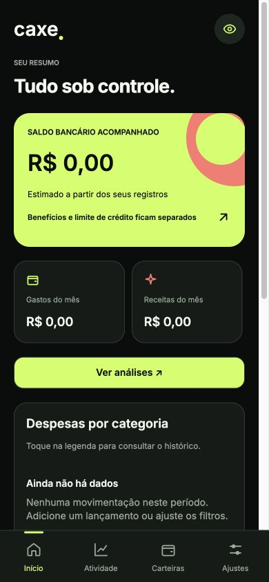

# Verificações — 7 de novembro de 2026

| Verificação | Resultado |
| --- | --- |
| `npm test` | 30 testes passaram |
| `npm run typecheck` | Passou |
| `tsc --noEmit --noUnusedLocals --noUnusedParameters` | Passou |
| `npm run native:bundle` | Bundles Hermes de Android e iOS gerados |
| `npm run web:build` | Bundle web, worker SQLite, WASM, fontes e logos gerados |
| `npm run api:check` | Worker empacotado em dry run, sem publicação |
| `npx expo install --check` | Dependências compatíveis com o mapa local do Expo 58; consulta remota indisponível no sandbox |
| `expo config --type introspect` | Serviço de captura, permissão de binding e consulta de aplicativos configurados |
| `expo prebuild --platform android --no-install` | Projeto Android gerado com autolinking do módulo local |
| `./gradlew :caxe-notifications:compileDebugKotlin --console=plain` | **BUILD SUCCESSFUL**, incluindo a compilação do Expo Modules Core |

## Conferência da interface

Prévia executada com SQLite persistente, sem servidor financeiro. A origem de teste foi separada da origem vazia usada na imagem entregue.

- Cadastro de carteira de teste e lançamento de R$ 82,90. Saldo inicial de R$ 1.000,00 passou a R$ 917,10; histórico, resumo, KPI e rosca mostraram R$ 82,90.
- Troca de logo para categoria e de categoria para logo, verificando o carrinho no tema Light e a logo roxa original no tema Dark.
- Reinício preservou a preferência, o tema e os registros no SQLite.
- Seleção de categoria na análise abriu o histórico com o mesmo filtro.
- Primeira abertura de uma origem vazia concluiu a inicialização do SQLite e mostrou os estados vazios.
- Layout conferido em 390 × 844. Tab ativa expõe `aria-selected=true`; controles de escolha expõem estado pressionado. Os gráficos possuem valores textuais consultáveis.
- Nenhum dado de teste foi incluído no banco inicial ou no código do aplicativo.

## Limites da validação

Não foram executados testes em aparelhos, uma compilação nativa iOS, a assinatura/distribuição do app ou login e sincronização contra um Neon real. Nenhum recurso foi publicado. O ambiente está com a licença do Xcode pendente. A captura Android depende da autorização do sistema e dos aplicativos selecionados; o iOS usa texto fornecido pelo usuário/Atalhos, sem leitura de notificações de terceiros.

O PostgreSQL dos testes usa o motor local PGlite: valida a instrução SQL, os vínculos, o controle de versão, a deduplicação e o isolamento por usuário. Não substitui uma validação de conectividade, sessão ou concorrência na infraestrutura de produção.
